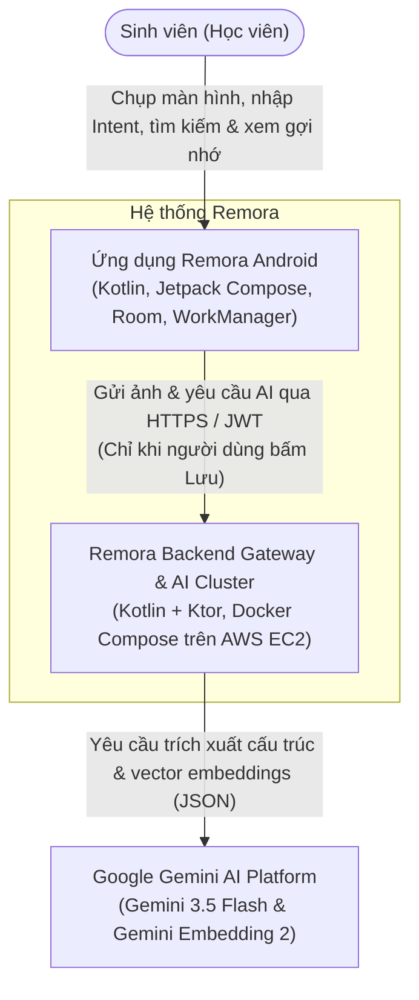
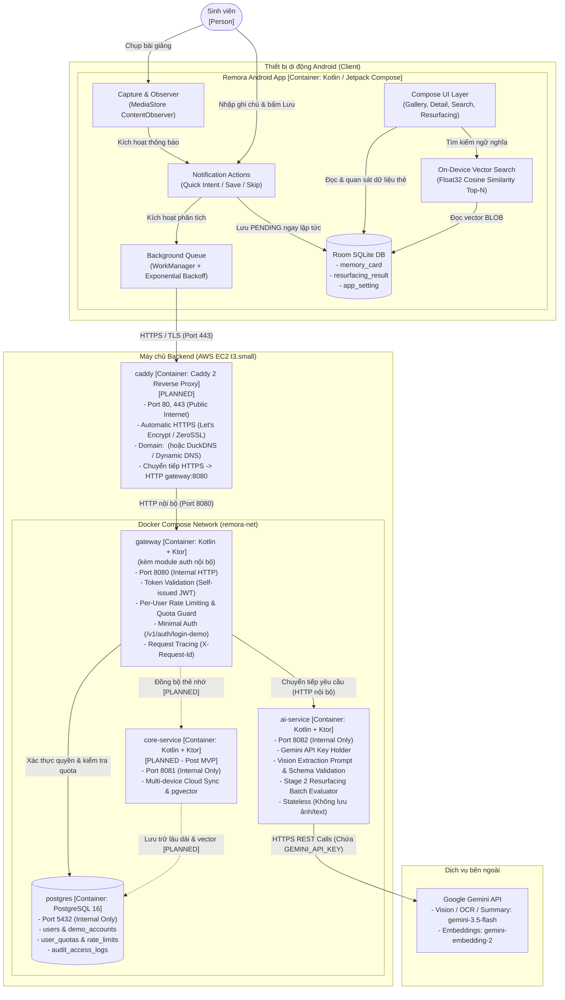

# 01. Bối cảnh hệ thống & Sơ đồ Container (C4 Model)

Tài liệu này mô tả kiến trúc Remora ở hai cấp độ: Cấp độ 1 - Bối cảnh hệ thống (System Context) và Cấp độ 2 - Sơ đồ phân rã Container (Containers Diagram), tuân thủ tiêu chuẩn C4 model và hiển thị bằng Mermaid.

---

## 1. System Context Diagram (C4 Level 1) `[PLANNED]`

Sơ đồ mô tả vị trí của Remora trong tương tác với Sinh viên (Người dùng chính) và các hệ thống bên ngoài:

---

## 2. Container Diagram (C4 Level 2) `[PLANNED]`

Sơ đồ thể hiện chi tiết các container thực thi của Remora trong phạm vi **MVP Slice** (24h Hackathon) và các khối đánh dấu `[PLANNED]` cho giai đoạn mở rộng:

---

## 3. Ranh giới tin cậy & Cách ly mạng (Trust Boundaries & Network Isolation)

1. **Ranh giới công cộng & TLS Termination (Public Boundary & Ingress):**
   - **Chính sách mạng Android (Cleartext Traffic Policy):** Mặc định từ Android 9 (API 28+), hệ điều hành **chặn hoàn toàn lưu lượng HTTP không mã hóa (Cleartext Traffic)**. Trong môi trường phát triển cục bộ (Debug), lập trình viên được phép bật cấu hình ngoại lệ tạm thời trong `res/xml/network_security_config.xml` để gọi IP máy ảo/localhost. Tuy nhiên, **bản build APK chạy Demo chấm thi bắt buộc phải gọi qua HTTPS an toàn**.
   - Container **Caddy** (hoặc Nginx) đóng vai trò TLS Terminator tại cổng `443` (tự động cấp chứng chỉ Let's Encrypt / ZeroSSL theo domain cấu hình, ví dụ `<DOMAIN>` hoặc DuckDNS/Dynamic DNS). Caddy giải mã TLS và forward lưu lượng HTTP nội bộ sang `gateway:8080`.
   - Toàn bộ giao tiếp giữa ứng dụng Android và `gateway` bắt buộc phải có `Authorization: Bearer <JWT>` (ngoại trừ endpoint lấy token `/v1/auth/login-demo`).

2. **Mạng nội bộ riêng tư (Private Docker Network `remora-net`):**
   - Các container `ai-service`, `postgres` (và `core-service` sau này) **hoàn toàn không mở cổng ra ngoài host** (`ports:` không map ra `0.0.0.0`).
   - Chúng chỉ liên lạc với nhau qua mạng ảo nội bộ Docker bridge network bằng tên định danh service (ví dụ: `http://ai-service:8082`, `jdbc:postgresql://postgres:5432/remora_db`).
   - `ai-service` chỉ chấp nhận các request có header xác thực nội bộ do `gateway` thêm vào (`X-Internal-Secret` hoặc danh tính chuyển tiếp `X-User-Id`).

3. **Ranh giới nhà cung cấp bên thứ ba (Third-party Boundary):**
   - Chỉ duy nhất `ai-service` được phép gọi ra Google Gemini API.
   - `ai-service` là container duy nhất được nạp biến môi trường `GEMINI_API_KEY`. Nếu `gateway` hay client bị rò rỉ cấu hình, API key vẫn được bảo vệ tuyệt đối trong mạng nội bộ.

---

## 4. Luồng dữ liệu chính trong MVP (Core Data Flows)

### Luồng A: Chụp ảnh -> Phân tích thẻ nhớ (Card Extraction Flow)
1. Sinh viên chụp bài giảng trên điện thoại; `CaptureModule` phát hiện qua `MediaStore`.
2. Hệ thống bắn Notification với 2 action chính: **Lưu (kèm ô nhập `user_intent`)** hoặc **Bỏ qua (Skip)**.
3. Người dùng nhập intent và bấm **Lưu** -> Card được ghi vào Room SQLite ở trạng thái `status = PENDING`. Giao diện cập nhật thẻ đang chờ xử lý.
4. `WorkerModule` (WorkManager) gửi ảnh đã nén kèm `user_intent` tới `gateway` `/v1/ai/extract-card`.
5. `gateway` kiểm tra JWT và trừ AI quota của sinh viên trong `postgres`, chuyển request sang `ai-service`.
6. `ai-service` gọi Gemini 3.5 Flash với JSON Schema bắt buộc (trích xuất `title`, `summary`, `tags`, `content_type`, `ocr_text`).
7. `ai-service` trả kết quả JSON về client -> Client cập nhật vào Room SQLite, sau đó tiếp tục yêu cầu sinh vector embedding qua `ai-service` `/v1/ai/embeddings`.
8. Sau khi có vector 768 chiều, Client chuẩn hóa L2, lưu vào cột BLOB `embedding` và đổi `status = DONE`.

### Luồng B: Memory Resurfacing 2 tầng (Gợi nhớ thông minh)
1. **Tầng 1 (On-Device Cosine):** Client lấy vector của thẻ mới, tính Cosine Similarity với toàn bộ thẻ đã lưu trong Room, chọn ra top-N (mặc định 15) ứng viên có độ tương đồng cao nhất.
2. **Tầng 2 (LLM Batch Evaluation):** Client gửi thẻ mới (gồm 5 trường text: `title`, `summary`, `tags`, `content_type`, `user_intent`) + danh sách N ứng viên lên `gateway` -> `ai-service` `/v1/ai/resurface-batch`. **Quy tắc bảo vệ quyền riêng tư nghiêm ngặt:** Đối với mỗi thẻ ứng viên cũ trong quá khứ, client **chỉ gửi đúng 6 trường metadata văn bản:** `candidate_id`, `title`, `summary`, `tags`, `content_type`, `user_intent`. **Tuyệt đối KHÔNG gửi `ocr_text` và KHÔNG gửi file ảnh của bất kỳ thẻ nào trong bước này**.
3. `ai-service` gọi Gemini 1 lần duy nhất cho toàn bộ lô ứng viên, trả về danh sách các liên kết tri thức thuộc 3 nhóm:
   - `SIMILAR` (Tương đồng: cùng chủ đề/dạng bài).
   - `COMPLEMENTARY` (Bổ trợ: lý thuyết cho bài tập hoặc ngược lại).
   - `ACTIONABLE` (Có giá trị sử dụng: công thức/mẫu giải có thể áp dụng ngay).
4. Client nhận kết quả, lọc theo ngưỡng tin cậy (`confidence > RESURFACE_MIN_CONFIDENCE`, tạm đặt 0.80 và dùng điều kiện `>`), lưu vào bảng Room `resurfacing_result` và hiển thị thông báo gợi nhớ cho sinh viên.
