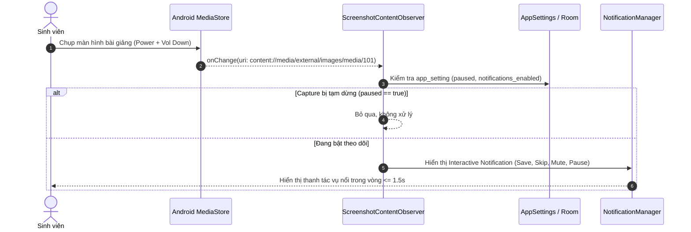
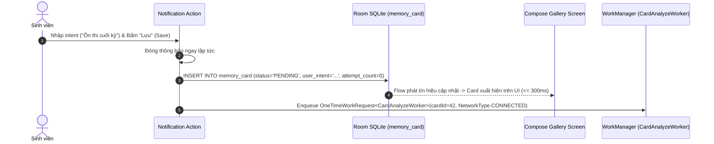

# Implementation Plan: Remora MVP (Second Brain for Study Screenshots)

**Branch**: `001-remora-mvp` | **Date**: 2026-10-22 | **Spec**: [specs/001-remora-mvp/spec.md](./spec.md)

**Input**: Feature specification from `/specs/001-remora-mvp/spec.md`, project constitution from `/.specify/memory/constitution.md`, architectural designs from `/docs/architecture/*`, and technical decisions from `/docs/decisions.md`.

---

## 1. Summary

Remora is an Android application that transforms study screenshots into a searchable, proactive "second brain" for students. The technical approach couples an Android client (Kotlin, Jetpack Compose, Room SQLite, WorkManager) with a lightweight backend proxy (`gateway` + `ai-service` in Kotlin/Ktor deployed via Docker Compose on AWS EC2 `t3.medium`). The AI pipeline leverages Google Gemini (`gemini-3.5-flash-lite` primary / `gemini-3.5-flash` fallback for multimodal vision/OCR extraction, `gemini-embedding-2` with 768 dimensions for semantic vectors, and a single-call batch LLM evaluator for Memory Resurfacing).

---

## 2. Technical Context

- **Language / Runtime**: Kotlin 1.9+, Java 17+, Android SDK 34 (`minSdk = 28`, `compileSdk = 34`).
- **Client Stack**: Android Jetpack Compose, Room SQLite (on-device vectors stored as Float32 BLOBs), WorkManager, Kotlin Coroutines & Flow, `kotlinx.serialization`, Timber.
- **Backend Stack**: Kotlin + Ktor (Netty engine) microservices in `services/` monorepo:
  - `gateway`: Port 8080 (internal), Reverse Proxy, Embedded Auth, JWT validation (HMAC-SHA256), Quota guard, Request tracing (`X-Request-Id`).
  - `ai-service`: Port 8082 (internal only), Gemini API key holder, vision extraction, text embeddings, Resurfacing batch evaluation.
  - `postgres`: PostgreSQL 16 Alpine container (port 5432) initialized via `init.sql`.
- **Target Platform**: Android 9.0+ devices; Server deployed via Docker Compose on AWS EC2 `t3.medium` (4GB RAM) in `ap-southeast-1` Singapore (`t3.small` as backup).
- **External AI Integration**: Google Gemini API via official REST / SDK behind `ai-service`.
- **Performance Goals**:
  - Screenshot detection action prompt latency: $\le 1.5$ seconds.
  - Save to local gallery PENDING transition: $\le 300$ milliseconds.
  - Background card extraction & embedding median latency: $< 4.0$ seconds.
  - On-device Top-15 Cosine search: $< 50$ milliseconds.
- **Constraints**: 24h Hackathon build, feature freeze at **h22**, zero image egress before user taps Save, no secrets in client APK/repo, 1 single LLM batch call for Resurfacing, `confidence > 0.80`. Approved AI pipeline planning decisions (2026-10-24): `tuần trước` is a rolling 7–14 day window; duplicate hashes require asking the user before reuse or separate save; prefer versioned JSON decoding and use Room migration only when necessary; FTS is conditional on benchmark evidence.

---

## 3. Constitution Check

*GATE: Checked against `.specify/memory/constitution.md` (v1.0.0).*

| Principle | Compliance Assessment | Status |
| --- | --- | --- |
| **I. Single Source of Truth & Spec Kit First** | All requirements flow from Spec Kit (`spec.md` $\rightarrow$ `plan.md` $\rightarrow$ `tasks.md`). Architectural parameters strictly mirror `docs/architecture/*` and `docs/decisions.md`. | PASS |
| **II. Privacy by Design & Zero-Leakage** | Images strictly remain on-device until the user taps Save. Backend `ai-service` is stateless; zero user images or full `ocr_text` stored in PostgreSQL. Resurfacing transmits metadata only. | PASS |
| **III. Secrets & Key Management** | Client APK holds no Gemini API keys or JWT secrets. Secrets injected via backend environment variables and `local.properties` (gitignored). | PASS |
| **IV. Cost & Quota Optimization** | Stage 2 Resurfacing batched into exactly 1 call. Client-side JPEG compression (1560px max, 80-85%). SHA-256 deduplication avoids redundant AI calls. | PASS |
| **V. Non-Blocking UI & Resilience** | UI inserts cards as `PENDING` instantly (< 300ms). WorkManager handles network retries with exponential backoff. HTTP 429 keeps cards `PENDING`. Graceful sanitization on partial AI output. | PASS |
| **VI. Verified Data & Anti-Hallucination** | Model IDs (`gemini-3.5-flash-lite`, `gemini-3.5-flash`, `gemini-embedding-2`), dimension 768, and Free Tier quotas (5 RPM / 20 RPD for flash) empirically verified on 2026-10-22. | PASS |
| **VII. Pure Logic Test-Driven Rigor** | Unit tests cover VectorMath, BLOB encode/decode, card JSON sanitization, time-range regex resolver, and Resurfacing grouping rules. | PASS |
| **VIII. Lean Architecture & Pragmatic Simplicity** | No Dagger/Hilt or Koin (Manual DI / AppContainer). No premature multi-module split. `core-service` and `auth-service` deferred to post-MVP. | PASS |
| **IX. Hackathon Realism & Demo Determinism** | 30–50 canonical cards pre-seeded for demo. Feature freeze at h22. EC2 `t3.medium` sized for demo stability. | PASS |

---

## 4. Project Structure & Module Boundaries

### 4.1 Monorepo Layout
```text
Remora/
├── .specify/                         # Spec Kit configuration, scripts & memory constitution
├── specs/001-remora-mvp/             # Feature specification & implementation artifacts
│   ├── spec.md                       # Approved specification
│   ├── plan.md                       # This implementation plan
│   ├── research.md                   # Phase 0: Technology decisions & verified facts
│   ├── data-model.md                 # Phase 1: Room SQLite & PostgreSQL schemas
│   ├── quickstart.md                 # Phase 1: Setup & demo runbook
│   └── contracts/                    # Phase 1: JSON Schema contracts
│       ├── auth-login.json
│       ├── card-extraction.json
│       ├── embedding.json
│       └── resurface-batch.json
├── core/
│   └── model/                        # Kotlin JVM pure logic module (shared types, VectorMath, contracts)
│       └── src/main/java/com/remora/core/model/
│           ├── entity/               # MemoryCard, Enums (ContentType, ProcessingStatus, etc.)
│           ├── contract/             # VectorMath, AiContracts, RepositoryContracts
│           └── resurface/            # ResurfaceModels & Grouping rules
├── app/                              # Android Application module (Kotlin / Compose / Room)
│   └── src/main/java/com/remora/
│       ├── capture/                  # MediaStore ContentObserver, notification action receiver
│       ├── data/                     # Room DB, DAOs, MemoryCardRepository, AppSettings
│       ├── ai/                       # Backend Gateway API client, token manager, image compressor
│       ├── search/                   # Cosine similarity search engine, Vietnamese TimeResolver
│       ├── resurfacing/              # Candidate selection (Stage 1), batch processor (Stage 2)
│       ├── ui/                       # Jetpack Compose UI (Gallery, CardDetail, Search, Resurfacing, Consent)
│       └── work/                     # WorkManager workers (CardAnalyzeWorker, RetryWorker)
├── services/                         # Backend Services (Separate Gradle build, Kotlin + Ktor)
│   ├── gateway/                      # Ingress API Gateway, minimal auth, rate limit, quota guard
│   │   ├── openapi.yaml              # Contract-first OpenAPI definition
│   │   └── src/                      # Ktor routes, JWT auth, proxy client, init.sql
│   ├── ai-service/                   # Internal AI Orchestration service
│   │   ├── openapi.yaml              # Internal OpenAPI definition
│   │   └── src/                      # Gemini multimodal client, prompt templates, schema validator
│   └── docker-compose.yml            # Local & staging orchestration (gateway, ai-service, postgres, caddy)
├── scripts/                          # Verification, doc-checking & model benchmark scripts
│   ├── demo-images/                  # 10 canonical lecture slides for demo & testing
│   ├── check-docs.js
│   ├── benchmark-models.js
│   └── test-resurfacing-contract.js
└── AGENTS.md                         # Rules of engagement for coding agents
```

### 4.2 Module Boundary Enforcement
- `:core:model` is a pure JVM library (`kotlin.jvm`). It has zero Android SDK dependencies, allowing rapid execution of unit tests directly in JVM CI.
- `services/` contains an independent Gradle project. It shares no compiled jar with `:core:model`. The contract boundary between Android and Backend is strictly maintained via OpenAPI 3.1.0 specifications (`services/gateway/openapi.yaml`).

---

## 5. Detailed Sequence Flows (Must-Have Flows)

### Flow 1: Automatic Screenshot Capture & Consent Check


### Flow 2: Privacy-First Save with User Intent (Non-Blocking UI)


### Flow 3: Asynchronous AI Extraction & Resilience Fallback
```mermaid
sequenceDiagram
    autonumber
    participant WM as CardAnalyzeWorker
    participant HashUtil as SHA-256 Hasher
    participant Compress as ImageCompressor
    participant Gateway as gateway:8080 (HTTPS)
    participant AIService as ai-service:8082
    participant Gemini as Google Gemini API
    participant Room as Room SQLite

    WM->>HashUtil: Tính SHA-256 hash của ảnh
    alt Ảnh đã tồn tại và status == DONE
        WM->>Room: Sao chép metadata thẻ cũ, chuyển status = DONE (Bỏ qua gọi AI)
    else Ảnh mới
        WM->>Compress: Resize (max 1560px) & Nén JPEG (80-85%, ~350KB)
        WM->>Gateway: POST /v1/ai/extract-card (Image + user_intent, Bearer JWT)
        Gateway->>AIService: Forward HTTP nội bộ
        AIService->>Gemini: gemini-3.5-flash-lite (JSON mode)
        alt Gemini thành công
            Gemini-->>AIService: JSON {title, summary, tags, content_type, ocr_text}
        else Gemini Lite 429 hoặc lỗi -> Fallback
            AIService->>Gemini: gemini-3.5-flash (Fallback model)
            Gemini-->>AIService: JSON
        end
        AIService->>Gemini: gemini-embedding-2 (RETRIEVAL_DOCUMENT, 768d)
        Gemini-->>AIService: 768-float array
        AIService-->>Gateway-->>WM: 200 OK ExtractedCardResponse + Embedding
        WM->>Room: UPDATE memory_card (title, summary, tags, ocr_text, embedding BLOB, status='DONE')
        WM->>WM: Kích hoạt Trigger Resurfacing cho thẻ mới
    end
```

### Flow 4: Natural-Language Semantic Search with Time Awareness
```mermaid
sequenceDiagram
    autonumber
    actor Student as Sinh viên
    participant UI as SearchScreen (Compose)
    participant Resolver as TimeResolver (Regex)
    participant Gateway as gateway:8080
    participant Room as Room SQLite
    participant VectorEngine as VectorMath (Dot Product)

    Student->>UI: Nhập truy vấn: "cái slide về phân phối chuẩn hôm bữa chụp"
    UI->>Resolver: resolve("cái slide về phân phối chuẩn hôm bữa chụp")
    Resolver-->>UI: {cleanQuery: "cái slide về phân phối chuẩn", dateRange: [now - 21 days, now]}
    UI->>Gateway: POST /v1/ai/embeddings {text: cleanQuery, task_type: RETRIEVAL_QUERY}
    Gateway-->>UI: Query Vector 768-Float32
    UI->>Room: Lấy danh sách thẻ có created_at nằm trong dateRange và status == DONE
    Room-->>UI: Danh sách candidate cards (kèm embedding BLOB)
    UI->>VectorEngine: Tính Dot Product giữa Query Vector và từng thẻ
    VectorEngine-->>UI: Điểm tương đồng cosine của từng thẻ
    UI->>UI: Lọc các thẻ có score >= 0.65; Sắp xếp giảm dần; Highlight user_intent
    UI-->>Student: Hiển thị thẻ "Phân phối chuẩn" ở vị trí #1
```

### Flow 5: Proactive Memory Resurfacing (2-Stage Pipeline)
```mermaid
sequenceDiagram
    autonumber
    participant Engine as ResurfacingEngine
    participant Room as Room SQLite
    participant VectorEngine as VectorMath
    participant Gateway as gateway:8080
    participant AIService as ai-service:8082
    participant Gemini as Google Gemini API
    participant Notif as Notification / UI Banner

    Engine->>Room: Lấy toàn bộ thẻ DONE (loại trừ thẻ mới id=42)
    Room-->>Engine: N thẻ trong cơ sở dữ liệu
    Engine->>VectorEngine: Tính Top-15 cosine similarity đối với vector thẻ mới (Stage 1)
    VectorEngine-->>Engine: 15 candidate cards
    Engine->>Gateway: POST /v1/ai/resurface-batch (Thẻ mới + 15 Candidates text-only)
    Gateway->>AIService: Forward HTTP
    AIService->>Gemini: Gọi LLM đúng 1 lần với batch candidates
    Gemini-->>AIService: JSON {results: [{candidate_id, group, relation, new_info, benefit, reason, confidence}]}
    AIService-->>Gateway-->>Engine: 200 OK ResurfaceBatchResponse
    Engine->>Engine: 1. Kiểm tra candidate_id là số nguyên có trong input<br>2. Kiểm tra group-relation hợp lệ<br>3. Lọc confidence > 0.80<br>4. Lấy tối đa 2 items / group
    alt Có kết quả hợp lệ
        Engine->>Room: Lưu vào bảng resurfacing_result
        Engine->>Notif: Hiển thị gợi nhớ Resurfacing 3 nhóm (SIMILAR, COMPLEMENTARY, ACTIONABLE)
    else Danh sách rỗng [] (Ca âm tính - Không có bài liên quan)
        Engine-->>Engine: Không hiển thị thông báo rác
    end
```

---

## 6. Testing Boundaries & Verification Matrix

To ensure stability during the 24h Hackathon build, tests are partitioned strictly between local JVM CI and manual device verification:

### 6.1 Automated JVM Unit Tests (Runs in CI on `./gradlew testDebugUnitTest`)
- **`VectorMathTest`**:
  - L2-normalization verification: $\sqrt{\sum v_i^2} = 1.0 \pm 10^{-5}$.
  - Float32 little-endian BLOB encode / decode roundtrip.
  - Dot product vs Cosine similarity equivalence for normalized vectors.
- **`CardExtractionParserTest`**:
  - Valid JSON parsing.
  - Sanitization fallback on missing fields: defaults `subject = "chưa phân loại"`, `content_type = UNKNOWN`.
  - Malformed JSON handling: retains image, transitions to retry or fallback without crashing.
- **`TimeResolverTest`**:
  - Vietnamese fuzzy regex matching: "hôm nay", "hôm qua", "tuần trước" (rolling 7–14 days before now), "hôm bữa" (~2–3 weeks).
  - Date window bounding and boundary edge conditions.
- **`ResurfacingGroupingTest`**:
  - Candidate ID integrity check: unknown IDs outside input pool are discarded.
  - Relation-group compatibility filter (e.g. `COMPLEMENTARY` rejects `DUPLICATE`).
  - Strict confidence threshold: accepts `0.81`, rejects `0.80` (`confidence > 0.80`).
  - Quota cap: maximum 2 items per group.
  - Negative case: empty input / empty response `[]` returns valid empty result.

### 6.2 Mandatory Real-Device Verification (Demo Phone Only)
These behaviors **CANNOT** be reliably validated in automated JVM tests or emulator and MUST be verified on the physical demo phone:
1. **Background Screenshot Capture**:
   - Verification that `MediaStore` + `ContentObserver` receives capture events while the phone is locked, when in home screen, and when running other apps (Chrome, PDF viewer).
   - Test foreground service persistence across battery-optimization kills on the specific demo phone vendor (Samsung / Xiaomi / Pixel).
2. **First-Time Consent Dialog**:
   - Verification that no network egress occurs before consent is granted.
3. **Notification Action Bar**:
   - Direct inline reply / text input for `user_intent` on Android 9+ notification shades.
   - Verification of prompt speed (< 1.5s) and instantaneous gallery update (< 300ms).
4. **End-to-End Demo Path Determinism**:
   - Full walkthrough from lecture slide capture to search retrieval under live conference Wi-Fi / 4G Hotspot.

---

## 7. Risks & Mitigation Strategy

| Risk | Impact | Likelihood | Mitigation Strategy |
| --- | --- | --- | --- |
| **Background Capture Process Killed by OS** | High | High | 1. Implement Foreground Service with persistent low-priority notification.<br>2. Request "Ignore Battery Optimization" in onboarding.<br>3. WorkManager content URI trigger fallback. |
| **Gemini API Latency Spike During Demo** | High | Medium | 1. Use `gemini-3.5-flash-lite` primary with fast `gemini-3.5-flash` fallback.<br>2. Pre-seed and cache 30–50 canonical cards so demo search and resurfacing work deterministically from local cache even with slow network.<br>3. Client-side image compression (down to ~300KB) cuts upload time by 80%. |
| **Gemini Quota Exhaustion (Free Tier Limits)** | High | Medium | 1. Per-user quota guard at Gateway (`DEMO_DAILY_QUOTA = 50`).<br>2. Batch Resurfacing into exactly 1 call (saves ~75% tokens).<br>3. SHA-256 duplicate detection asks the user whether to reuse the existing card or save a separate card.<br>4. Prepared backup API key and paid tier option if decided. |
| **Conference Wi-Fi Network Instability** | High | High | 1. Dedicated 4G/5G mobile hotspot for demo phone and laptop.<br>2. WorkManager offline queue keeps cards `PENDING` without crashing.<br>3. Screen recording video backup prepared after h22 freeze. |
| **Model ID / API Parameter Deprecation** | High | Low | All model IDs (`gemini-3.5-flash-lite`, `gemini-embedding-2`) and parameters verified live on 2026-10-22 and documented in `docs/decisions.md`. |

## Approved AI Pipeline Decisions and Planning Updates (2026-10-24)

These decisions supersede any conflicting earlier wording in this artifact:

- Search phrase "tuần trước" means the rolling window from 14 days before now through 7 days before now, not the previous calendar week. Add fixed-clock tests for the boundaries.
- When a screenshot hash matches an existing card, ask the user whether to reuse/link to the existing card or save a separate card. Never silently deduplicate or silently create a duplicate.
- Prefer a versioned JSON decoder and lazy normalization for legacy tags JSON. Use Room migration only if a concrete requirement cannot be met safely without a database schema change.
- SQLite FTS remains conditional. Implement it only if a controlled, versioned benchmark demonstrates meaningful benefit over semantic-only retrieval without unacceptable latency, reliability, or privacy regressions.
- These planning updates do not authorize product-code changes. Product-code implementation remains blocked until the user approves the final implementation plan.
