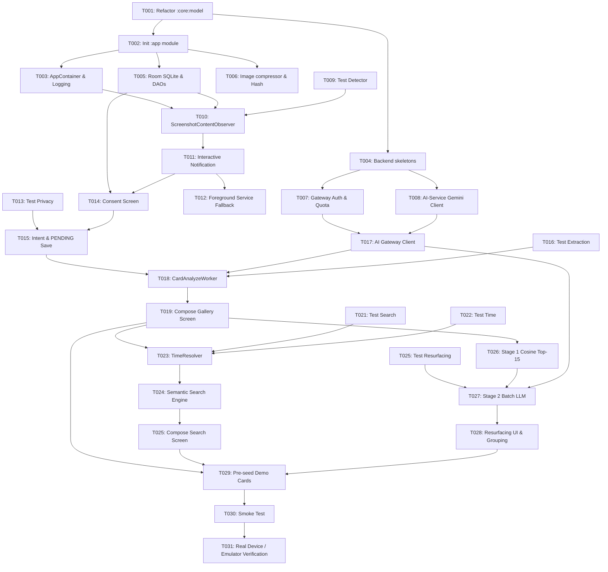

# Tasks: Remora MVP (Second Brain for Study Screenshots)

**Input**: Design documents from `/specs/001-remora-mvp/` (`spec.md`, `plan.md`, `data-model.md`, `research.md`, `quickstart.md`, `contracts/`).  
**Governance**: Rules of engagement from `AGENTS.md` and `.specify/memory/constitution.md`.  
**Target Cut Line**: Feature Freeze at **h22**. All **[P0] (Must-Have)** tasks must be completed before freeze; **[P1] (Should-Have)** are executed only if time allows; **[P2] (Could-Have)** are strictly deferred.

---

## Format: `[ID] [Priority] [Parallel?] [Story?] Description`

- **[P0]**: Must-Have (MVP 24h Hackathon core path).
- **[P1]**: Should-Have (Enhancements after Must-Have complete).
- **[P2]**: Could-Have (Post-MVP / Deferred).
- **[P]**: Can run in parallel with other tasks (independent files/concerns).
- **[Story]**: Associated user story from `spec.md` (`US1` to `US5`).

---

## Phase 1: Setup & Foundational Refactoring (BẮT BUỘC)

**Purpose**: Core model refactoring and basic project/module initialization.

- [x] **T001 [P0] Refactor `:core:model` entities, enums, contracts and tests**
  - **File Paths**:
    - `core/model/src/main/java/com/remora/core/model/entity/MemoryCard.kt` (rename & refactor from `Screenshot.kt`)
    - `core/model/src/main/java/com/remora/core/model/entity/Enums.kt`
    - `core/model/src/main/java/com/remora/core/model/resurface/ResurfaceModels.kt`
    - `core/model/src/main/java/com/remora/core/model/contract/AiContracts.kt`
    - `core/model/src/test/java/com/remora/core/model/contract/VectorMathTest.kt`
    - `core/model/src/test/java/com/remora/core/model/entity/MemoryCardTest.kt`
    - `core/model/src/test/java/com/remora/core/model/resurface/ResurfaceModelsTest.kt`
  - **Acceptance Criteria**:
    - `Screenshot` renamed to `MemoryCard` with exact fields: `id`, `imageUri`, `createdAt`, `userIntent`, `title`, `summary`, `tags` (`subject`, `topics`), `contentType`, `ocrText`, `embedding`, `status`, `attemptCount`, `errorCode`.
    - `ProcessingStatus` streamlined to exactly 3 values: `PENDING`, `DONE`, `FAILED` (no ML Kit enum).
    - `ResurfaceGroup` has `SIMILAR`, `COMPLEMENTARY`, `ACTIONABLE`.
    - `ResurfaceRelation` has `DUPLICATE`, `SUPPLEMENT`, `EXPLANATION`, `CONTRADICTION`.
    - Pure logic unit tests pass via `./gradlew :core:model:test` with 0 failures.

- [x] **T002 [P0] Initialize `:app` Android module and Gradle configuration**
  - **File Paths**:
    - `app/build.gradle.kts`
    - `settings.gradle.kts`
    - `app/src/main/AndroidManifest.xml`
  - **Acceptance Criteria**:
    - `include(":app")` activated in `settings.gradle.kts`.
    - `applicationId = "com.remora"`, `minSdk = 28`, `compileSdk = 34`, `targetSdk = 34`.
    - Compose, Room SQLite, WorkManager, Coroutines, and `kotlinx.serialization` dependencies configured.
    - Project compiles cleanly with `./gradlew :app:assembleDebug`.

- [x] **T003 [P0] [P] Setup Manual DI Container (AppContainer) and Logging in `:app`**
  - **File Paths**:
    - `app/src/main/java/com/remora/RemoraApp.kt`
    - `app/src/main/java/com/remora/di/AppContainer.kt`
  - **Acceptance Criteria**:
    - `AppContainer` interface and `DefaultAppContainer` provide singleton instances of database, network client, and repositories.
    - Zero Dagger/Hilt/Koin annotations used.
    - Timber logging configured; logs format `X-Request-Id` and omit raw images/OCR text.

- [x] **T004 [P0] [P] Initialize Backend Gateway and AI Service skeletons**
  - **File Paths**:
    - `services/gateway/src/main/kotlin/com/remora/gateway/Application.kt`
    - `services/gateway/src/main/resources/application.conf`
    - `services/ai-service/src/main/kotlin/com/remora/ai/Application.kt`
    - `services/ai-service/src/main/resources/application.conf`
    - `services/gateway/init.sql`
  - **Acceptance Criteria**:
    - Ktor Netty applications start on port 8080 (`gateway`) and 8082 (`ai-service`).
    - `init.sql` provisions `remora_auth.users`, `user_quotas`, and `audit_access_logs`.
    - Health check `/v1/health` returns HTTP 200 OK.

---

## Phase 2: Foundational Infrastructure (Blocking Prerequisites)

**Purpose**: Room SQLite persistence, image utilities, and backend gateway auth/proxy.

- [x] **T005 [P0] Implement Room SQLite database and DAOs**
  - **File Paths**:
    - `app/src/main/java/com/remora/data/local/RemoraDatabase.kt`
    - `app/src/main/java/com/remora/data/local/MemoryCardDao.kt`
    - `app/src/main/java/com/remora/data/local/ResurfacingResultDao.kt`
    - `app/src/main/java/com/remora/data/local/AppSettingDao.kt`
    - `app/src/main/java/com/remora/data/local/Converters.kt`
  - **Acceptance Criteria**:
    - Tables `memory_card`, `resurfacing_result`, `app_setting` match `data-model.md`. Room v2 explicit migration preserves user consent state.
    - `Converters.kt` serializes 768 Float32 arrays into 3,072-byte BLOBs (little-endian) and tags into JSON.
    - Room DAOs expose reactive Kotlin `Flow<List<MemoryCard>>`. Granular column updates for `app_setting` via `ensureRow()`, `setConsent`, `setPaused`, `setPauseUntil`, `setNotificationsEnabled`.

- [x] **T006 [P0] [P] Implement image processing utilities (SHA-256 deduplication & compression)**
  - **File Paths**:
    - `app/src/main/java/com/remora/util/ImageCompressor.kt`
    - `app/src/main/java/com/remora/util/HashUtil.kt`
    - `app/src/test/java/com/remora/util/HashUtilTest.kt`
  - **Acceptance Criteria**:
    - `HashUtil` generates SHA-256 hex string from image byte stream.
    - `ImageCompressor` downsizes images exceeding 1560px max dimension and compresses to JPEG (quality 80-85%, $\le 500$KB).

- [x] **T007 [P0] [P] Implement Backend Gateway Auth & Quota Guard**
  - **File Paths**:
    - `services/gateway/src/main/kotlin/com/remora/gateway/Application.kt`
    - `services/gateway/src/test/kotlin/com/remora/gateway/GatewayTest.kt`
  - **Acceptance Criteria**:
    - `POST /v1/auth/login-demo` reads `JWT_SECRET`, `DEMO_USERNAME`, `DEMO_PASSWORD` strictly from env (fails to boot if missing).
    - IP-based rate limiting on login endpoint (HTTP 429 after 5 failed attempts per minute).
    - Enforces real user daily quota (50 requests/day) with in-memory thread-safe quota counter.
    - Proxies all 3 AI endpoints (`/v1/ai/extract-card`, `/v1/ai/embeddings`, `/v1/ai/resurface-batch`) to `ai-service` attaching `X-Internal-Service-Key`.
    - Implements `/v1/healthz` and `/v1/readyz`; CORS is eliminated.

- [x] **T008 [P0] [P] Implement Backend AI-Service Gemini Multimodal & Embedding Client**
  - **File Paths**:
    - `services/ai-service/src/main/kotlin/com/remora/ai/Application.kt`
    - `services/ai-service/src/test/kotlin/com/remora/ai/AiServiceTest.kt`
  - **Acceptance Criteria**:
    - Real Gemini API calls (reads `GEMINI_*` from env). Zero mocks.
    - Multipart image + `user_intent` extraction via `gemini-3.5-flash-lite` (with fallback to `gemini-3.5-flash` on 429/503).
    - 768-dimensional L2-normalized embeddings via `gemini-embedding-2` (`RETRIEVAL_DOCUMENT` and `RETRIEVAL_QUERY`).
    - Single-call batch resurfacing adhering to decisions.md rules, prompt, and JSON response schema.
    - Strictly checks `INTERNAL_SERVICE_KEY` header for all protected endpoints.

**Checkpoint**: Core foundation and backend mock/services ready. User story implementation can proceed.

---

## Phase 3: User Story 1 - Automatic Screenshot Capture & Actions (Priority: P0)

**Goal**: Automatically detect newly captured study screenshots and display action prompt (Save, Skip, Mute 1h, Pause) within 1.5s.

- [x] **T009 [P0] [US1] Unit test for Screenshot URI detection and path filtering**
  - **File Path**: `app/src/test/java/com/remora/capture/ScreenshotDetectorTest.kt`
  - **Acceptance Criteria**:
    - Validates detection of `image/*` MIME type and `Pictures/Screenshots` directory path.
    - Ignores non-screenshot image creations (e.g. camera, downloads).

- [x] **T010 [P0] [US1] Implement ScreenshotContentObserver and MediaStore listener**
  - **File Path**: `app/src/main/java/com/remora/capture/ScreenshotObserver.kt`
  - **Acceptance Criteria**:
    - Listens to `MediaStore.Images.Media.EXTERNAL_CONTENT_URI`.
    - Deduplicates by media ID (`lastHandledMediaId`) and limits to fresh captures ($\le 30$ seconds).
    - Checks `IS_PENDING` on Android 10+ to wait for OS image file flush.
    - Respects `app_setting.paused == true` by ignoring capture events.

- [x] **T011 [P0] [US1] Implement interactive notification channel with instant actions**
  - **File Paths**:
    - `app/src/main/java/com/remora/capture/NotificationHelper.kt`
    - `app/src/main/java/com/remora/capture/CaptureActionReceiver.kt`
  - **Acceptance Criteria**:
    - Displays heads-up notification with action buttons: "Lưu (Save)", "Bỏ qua (Skip)", "Tắt 1h (Mute)", "Tạm dừng (Pause)".
    - Uses `goAsync()` in `CaptureActionReceiver` to ensure process safety during asynchronous Room writes.
    - Displays within $\le 1.5$s on real device / emulator.
    - Dismisses notification immediately upon tapping any action.

- [x] **T012 [P0] [US1] Implement Foreground Service fallback for background persistence**
  - **File Paths**:
    - `app/src/main/java/com/remora/capture/CaptureForegroundService.kt`
    - `app/src/main/java/com/remora/MainActivity.kt`
  - **Acceptance Criteria**:
    - Requests runtime permissions `READ_MEDIA_IMAGES` and `POST_NOTIFICATIONS` (Android 13+) or `READ_EXTERNAL_STORAGE`.
    - Service is started safely outside composition (only after permissions are granted).
    - Low-priority persistent notification allows continuous monitoring without OS kill.

**Checkpoint**: User Story 1 fully functional. Screenshot capture prompts appear reliably.

---

## Phase 4: User Story 2 - Privacy-First Saving with Student Intent (Priority: P0)

**Goal**: Capture optional student note (`user_intent`), enforce first-run consent, and guarantee zero network egress before Save confirmation.

- [x] **T013 [P0] [US2] Unit tests for privacy egress boundary and deduplication**
  - **File Path**: `app/src/test/java/com/remora/data/PrivacyBoundaryTest.kt`
  - **Acceptance Criteria**:
    - Real network egress interception asserting SKIP and PAUSE generate strictly 0 network calls and 0 database writes.
    - Asserts card is created as `PENDING` only after user commits via SAVE action.
    - Asserts SHA-256 duplicate image detection reuses existing card without network egress.

- [x] **T014 [P0] [US2] Implement Consent Onboarding Screen (Jetpack Compose)**
  - **File Paths**:
    - `app/src/main/java/com/remora/ui/consent/ConsentScreen.kt`
    - `app/src/main/java/com/remora/ui/consent/ConsentViewModel.kt`
  - **Acceptance Criteria**:
    - Clear Vietnamese disclosure: "Ảnh chỉ rời thiết bị sau khi bấm Lưu; server không lưu ảnh".
    - Stores consent state in `app_setting.consent_granted` (separated from `notifications_enabled`). Screenshot monitoring only activates after consent granted.

- [x] **T015 [P0] [US2] Implement inline intent capture and PENDING card insertion**
  - **File Paths**:
    - `app/src/main/java/com/remora/capture/CaptureActionReceiver.kt`
    - `app/src/main/java/com/remora/data/repository/MemoryCardRepository.kt`
  - **Acceptance Criteria**:
    - Direct inline text input for `user_intent` on notification shade.
    - Tapping Save inserts a `memory_card` record with `status = PENDING` in Room SQLite within $\le 300$ms.
    - Enqueues `CardAnalyzeWorker` into WorkManager.

**Checkpoint**: User Story 2 complete. Privacy boundary strictly guarded; PENDING cards created instantly.

---

## Phase 5: User Story 3 - Asynchronous Card Extraction & Resilience (Priority: P0)

**Goal**: Extract card metadata (title, summary, tags, content_type, verbatim OCR text, 768d embedding) in background; handle network failure and rate limits gracefully.

- [x] **T016 [P0] [US3] Unit tests for Card extraction JSON parsing and sanitization fallbacks**
  - **File Path**: `app/src/test/java/com/remora/ai/CardExtractionParserTest.kt`
  - **Acceptance Criteria**:
    - Parses valid Gemini JSON output.
    - Sanitizes missing fields: sets `subject = "chưa phân loại"`, `content_type = UNKNOWN`.
    - Preserves valid fields without crashing or dropping image.

- [x] **T017 [P0] [US3] Implement Backend AI Gateway proxy client in Android**
  - **File Paths**:
    - `app/src/main/java/com/remora/ai/AiGatewayClient.kt`
    - `app/src/main/java/com/remora/ai/model/ApiModels.kt`
  - **Acceptance Criteria**:
    - Uploads compressed JPEG multipart + `user_intent` with Bearer JWT to `/v1/ai/extract-card`.
    - Handles HTTP 401 by refreshing demo token; handles HTTP 429 by extracting `Retry-After`.

- [x] **T018 [P0] [US3] Implement CardAnalyzeWorker with WorkManager**
  - **File Paths**:
    - `app/src/main/java/com/remora/work/CardAnalyzeWorker.kt`
    - `app/src/test/java/com/remora/work/WorkerErrorClassificationTest.kt`
  - **Acceptance Criteria**:
    - Bound to `NetworkType.CONNECTED`.
    - No mock bytes: unreadable or corrupted images immediately fail as `FAILED`.
    - Retries upon embedding generation failure.
    - Classifies HTTP 400/401/403/404 as non-retryable client errors (`FAILED`).
    - Classifies HTTP 429 and 5xx as retryable with exponential backoff and `Retry-After`.
    - Wires Retry button in Gallery UI directly to `WorkManager.enqueue()`.

- [x] **T019 [P0] [US3] Implement Compose Gallery Screen with real-time status updates**
  - **File Paths**:
    - `app/src/main/java/com/remora/ui/gallery/GalleryScreen.kt`
    - `app/src/main/java/com/remora/ui/gallery/GalleryViewModel.kt`
    - `app/src/main/java/com/remora/ui/gallery/CardDetailScreen.kt`
  - **Acceptance Criteria**:
    - Displays card list reacting to Room Flow.
    - Shows "Đang xử lý AI..." badge for `PENDING` cards.
    - Shows "Thử lại (Retry)" button for `FAILED` cards.
    - Card detail shows image, title, summary, subject, tags, content type, and verbatim OCR.

**Checkpoint**: User Story 3 complete. Knowledge cards extracted, embedded, and displayed asynchronously.

---

## Phase 6: User Story 4 - Natural-Language Semantic Search & Time Resolver (Priority: P0)

**Goal**: Search cards via conversational Vietnamese queries and approximate time phrases; rank by cosine similarity; filter junk results.

- [x] **T020 [P0] [US4] Unit test for Vietnamese fuzzy time regex resolver**
  - **File Path**: `app/src/test/java/com/remora/search/TimeResolverTest.kt`
  - **Acceptance Criteria**:
    - "hôm qua" $\rightarrow [startOfYesterday, endOfYesterday]$.
    - "tuần trước" $\rightarrow [startOfLastWeek, endOfLastWeek]$.
    - "hôm bữa", "mấy hôm trước" $\rightarrow [now - 21\text{ days}, now]$.
    - "hôm nay", "tuần này" bounded correctly; unmatched queries return full range.

- [x] **T021 [P0] [US4] Unit test for on-device vector search and relevance threshold**
  - **File Path**: `app/src/test/java/com/remora/search/SemanticSearchEngineTest.kt`
  - **Acceptance Criteria**:
    - Verifies dot product matches cosine similarity on L2-normalized BLOB vectors.
    - Filters out candidates with similarity score $< 0.65$.

- [x] **T022 [P0] [US4] Implement Vietnamese TimeResolver utility**
  - **File Path**: `app/src/main/java/com/remora/search/TimeResolver.kt`
  - **Acceptance Criteria**:
    - Extracts temporal keywords from Vietnamese query string.
    - Returns `ResolvedSearchQuery(cleanQuery: String, startTimeMs: Long?, endTimeMs: Long?)`.

- [x] **T023 [P0] [US4] Implement on-device Semantic Search Engine**
  - **File Path**: `app/src/main/java/com/remora/search/SemanticSearchEngine.kt`
  - **Acceptance Criteria**:
    - Requests query embedding vector from `/v1/ai/embeddings` (`RETRIEVAL_QUERY`).
    - Pre-filters Room cards by `created_at` timestamp if time bounds present.
    - Computes vector dot product on-device; ranks descending; discards results $< 0.65$.

- [x] **T024 [P0] [US4] Implement Compose Search Screen with intent highlighting**
  - **File Paths**:
    - `app/src/main/java/com/remora/ui/search/SearchScreen.kt`
    - `app/src/main/java/com/remora/ui/search/SearchViewModel.kt`
  - **Acceptance Criteria**:
    - Search input field with real-time or debounce search.
    - Displays matching cards with student's original `user_intent` visually highlighted.
    - Displays "Không tìm thấy kết quả" empty state when similarity is below threshold.

**Checkpoint**: User Story 4 complete. Students can retrieve cards via natural Vietnamese and fuzzy time expressions.

---

## Phase 7: User Story 5 - Proactive Memory Resurfacing 2-Stage Pipeline (Priority: P0)

**Goal**: Proactively resurface related past knowledge organized into 3 groups (`SIMILAR`, `COMPLEMENTARY`, `ACTIONABLE`) upon saving a new card via single batch call.

- [x] **T025 [P0] [US5] Unit tests for Resurfacing grouping, candidate integrity, and thresholds**
  - **File Path**: `app/src/test/java/com/remora/resurfacing/ResurfacingValidatorTest.kt`
  - **Acceptance Criteria**:
    - Drops any `candidate_id` not matching the input candidate list.
    - Enforces group-relation matrix: `SIMILAR` $\rightarrow$ `DUPLICATE|SUPPLEMENT`; `COMPLEMENTARY` $\rightarrow$ `EXPLANATION|SUPPLEMENT`; `ACTIONABLE` $\rightarrow$ `SUPPLEMENT|CONTRADICTION`.
    - Rejects `confidence <= 0.80`; accepts `confidence > 0.80`.
    - Enforces max 2 items per group.
    - Validates empty array `[]` as successful negative case.

- [x] **T026 [P0] [US5] Implement Stage 1 candidate selector (On-device Top-15)**
  - **File Path**: `app/src/main/java/com/remora/resurfacing/Stage1CandidateSelector.kt`
  - **Acceptance Criteria**:
    - Retrieves all `DONE` cards excluding the new card.
    - Computes dot product against new card vector; returns Top-15 candidates.
    - Executes on-device in $< 50$ms.

- [x] **T027 [P0] [US5] Implement Stage 2 batch evaluation client and Backend AI Route**
  - **File Paths**:
    - `services/ai-service/src/main/resources/prompts/resurfacing_batch_v1.txt`
    - `services/ai-service/src/main/kotlin/com/remora/ai/routes/ResurfaceRoutes.kt`
    - `app/src/main/java/com/remora/resurfacing/Stage2BatchEvaluator.kt`
  - **Acceptance Criteria**:
    - Batches new card + up to 15 candidates into **exactly 1 Gemini prompt**.
    - Transmits text metadata only (0 images, 0 OCR text).
    - Returns structured JSON adhering to `contracts/resurface-batch.json`.

- [x] **T028 [P0] [US5] Implement Resurfacing result processor, Room persistence, and UI Presentation**
  - **File Paths**:
    - `app/src/main/java/com/remora/resurfacing/ResurfacingManager.kt`
    - `app/src/main/java/com/remora/ui/resurfacing/ResurfacingScreen.kt`
    - `app/src/main/java/com/remora/capture/NotificationHelper.kt`
    - `app/src/test/java/com/remora/resurfacing/ResurfacingFlowTest.kt`
  - **Acceptance Criteria**:
    - Triggered automatically by `CardAnalyzeWorker` immediately after card reaches `DONE` status.
    - Validates batch response using invariants from T025; saves to `resurfacing_result` table.
    - Observes `resurfacingResultDao.getLatestSourceCardIdFlow()` in `GalleryViewModel` and presents cards grouped pedagogically on `ResurfacingScreen`.
    - Dispatches high-value notification via `NotificationHelper.showResurfacingAlert`.
    - Shows 3 distinct groups with reasons and benefits; zero popups if result is empty `[]`.

**Checkpoint**: User Story 5 complete. Signature Memory Resurfacing flow operational.

---

## Phase 8: Polish, Demo Determinism & Real-Device Validation (Priority: P0)

**Purpose**: Guarantee rock-solid stability and determinism for the live Hackathon presentation.

- [x] **T029 [P0] Pre-seed 30–50 canonical demo cards for determinism**
  - **File Path**: `app/src/main/java/com/remora/data/seed/DemoDataSeeder.kt`
  - **Acceptance Criteria**:
    - Only runs on `BuildConfig.DEBUG` builds; disabled in release.
    - Replaces all random RNG vectors with deterministic sinusoidal orthogonal projections.
    - Bundles 10 real educational slide images in `app/src/main/assets/` (no fake/broken URIs).
    - Works offline from local cache during presentation.

- [x] **T030 [P0] Compose UI End-to-End Smoke Test**
  - **File Path**: `app/src/androidTest/java/com/remora/ui/SmokeTest.kt`
  - **Acceptance Criteria**:
    - Automates flow: Open App $\rightarrow$ Tap Save $\rightarrow$ Card appears in Gallery $\rightarrow$ Search returns matching slide.
    - Passes on Android Emulator (`Medium_Phone_API_37.0`).

- [x] **T031 [P0] Verification on Emulator & Real Demo Device**
  - **Acceptance Criteria**:
    - Verify background capture, inline intent notification, consent dialog, and demo walkthrough on `Medium_Phone_API_37.0` and physical phone.
    - Output proof: `./gradlew lint testDebugUnitTest assembleDebug` passes with zero errors.

---

## ═══════════════ CUT LINE (Feature Freeze at h22) ═══════════════

*Tasks below are Should-Have / Could-Have and MUST NOT begin until all Phase 1–8 tasks pass.*

## Phase 9: Extensions & Post-MVP Enhancements (Priority: P1 / P2)

- [x] **T032 [P1] Settings Screen for screenshot monitoring and pause timer**
  - **File Path**: `app/src/main/java/com/remora/ui/settings/SettingsScreen.kt`
  - **Acceptance Criteria**: Allows user to toggle capture on/off or pause for 1 hour.
  - **Implementation Status**: Hoàn thành qua `SettingsViewModel` + `AppSettingDao`. Kết nối trực tiếp CSDL Room (`app_setting`), hỗ trợ bật/tắt tự động nhận diện ảnh chụp (cờ `paused`), hiển thị thời gian tạm dừng có thời hạn (`pause_until` / "Đang tắt đến HH:mm"), và bật/tắt thông báo gợi nhớ (`notifications_enabled`). Có bộ unit tests đầy đủ trong `SettingsViewModelTest`.

- [ ] **T033 [P2] Full-Text Keyword Search (FTS) SQLite virtual table**
  - **File Path**: `app/src/main/java/com/remora/data/local/MemoryCardFtsDao.kt`
  - **Acceptance Criteria**: Provides exact keyword search over `ocr_text`.

- [ ] **T034 [P2] Bulk Gallery Import Worker**
  - **File Path**: `app/src/main/java/com/remora/work/BulkImportWorker.kt`
  - **Acceptance Criteria**: Scans historical screenshots and imports into Remora library.

---

## Dependencies & Execution Order

---

## Parallel Execution Opportunities

- **Batch 1 (Setup & Foundational)**:
  - T003 (`AppContainer`) and T004 (`Backend skeletons`) can run in parallel while T002 initializes `:app`.
  - T006 (`ImageCompressor`) can run in parallel with T005 (`Room SQLite`).
  - T007 (`Gateway Auth`) and T008 (`AI-Service Client`) can run in parallel.
- **Batch 2 (User Stories)**:
  - T009, T013, T016, T020, T021, T025 (Unit Tests) can be authored in parallel with foundational components.
  - Backend prompt tuning (`resurfacing_batch_v1.txt`, `card_extraction_v1.txt`) can proceed while Android UI screens are composed.
